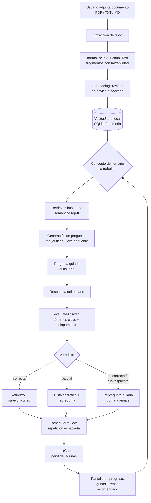

# Arquitectura del MVP — Socracia

## 1. Visión general

Socracia es una app móvil de autoaprendizaje basada en la **mayéutica**: en lugar
de mostrar teoría y tests, formula preguntas guiadas sobre el material del propio
usuario, evalúa las respuestas, detecta lagunas y construye un itinerario de
asimilación progresiva.

El sistema se organiza en tres capas con una regla de dependencia estricta:
**la UI depende del dominio, el dominio no depende de nada.**

```
┌──────────────────────────────────────────────────────────────┐
│  apps/mobile — Expo + React Native + TypeScript              │
│  Pantallas, navegación, permisos, persistencia SQLite,        │
│  módulos nativos (edge-llm / MediaPipe) tras adaptadores      │
└───────────────┬──────────────────────────────────────────────┘
                │ depende de (workspace: @socracia/core)
┌───────────────▼──────────────────────────────────────────────┐
│  packages/core — dominio puro TypeScript                     │
│                                                              │
│   domain/   modelo de datos (temario, conceptos, preguntas,   │
│             respuestas, lagunas, repaso espaciado)            │
│   rag/      chunking → embeddings → almacén vectorial →      │
│             recuperación semántica (RagEngine)                │
│   mayeu/    generación de preguntas socráticas, evaluación    │
│             de respuestas, detección de lagunas, SM-2         │
│   math/     similitud coseno y utilidades vectoriales         │
└───────────────┬──────────────────────────────────────────────┘
                │ implementado por (inyección de dependencias)
┌───────────────▼──────────────────────────────────────────────┐
│  Adaptadores (Sprint 2+)                                     │
│   EmbeddingProvider → hashing local | MediaPipe BERT | cloud  │
│   VectorStore       → memoria | SQLite+vector | ANN           │
└──────────────────────────────────────────────────────────────┘
```

### Por qué esta separación

- **Testabilidad:** toda la lógica crítica (RAG, generación, evaluación, lagunas,
  repaso) se prueba con Jest en Node, en milisegundos, sin simuladores ni
  módulos nativos.
- **Portabilidad:** el mismo `core` sirve para iOS y Android.
- **Sustituibilidad:** cambiar RAG on-device por RAG en backend (o al revés) es
  implementar una interfaz, no reescribir la app (ver `rag-strategy.md`).

## 2. Estructura del repositorio

```
Socracia/
├── apps/
│   └── mobile/                 # Expo + RN + TS
│       ├── App.tsx             # raíz de la app
│       ├── index.ts            # registerRootComponent
│       ├── app.json            # configuración Expo (bundle id, versiones)
│       ├── metro.config.js     # resolución de monorepo
│       └── src/
│           ├── screens/        # pantallas
│           ├── components/     # componentes reutilizables
│           └── theme/          # tokens de diseño
├── packages/
│   └── core/                   # dominio puro (@socracia/core)
│       └── src/
│           ├── domain/         # tipos del modelo
│           ├── math/           # similitud coseno
│           ├── rag/            # chunking, embeddings, vector store, engine
│           ├── mayeu/          # motor mayéutico
│           └── __tests__/      # pruebas unitarias e integración
├── docs/                       # arquitectura, estrategia RAG, decisiones
├── .openhands/setup.sh         # bootstrap del entorno
├── eslint.config.mjs           # ESLint flat config
└── package.json                # npm workspaces + scripts raíz
```

## 3. Flujo mayéutico (diagrama)



El bucle se cierra sobre el temario: cada respuesta actualiza el estado de
repaso y el perfil de lagunas, y el sistema elige el siguiente concepto con
mayor urgencia de asimilación.

## 4. Contratos del dominio

| Entidad             | Rol                                                        |
| ------------------- | ---------------------------------------------------------- |
| `KnowledgeDocument` | Documento del usuario, con `cloudConsent` explícito        |
| `KnowledgeChunk`    | Fragmento indexable con rango `charStart`/`charEnd`        |
| `Topic` / `Concept` | Temario y conceptos atómicos evaluables                    |
| `SocraticQuestion`  | Pregunta con `move`, `level`, `keyTerms` y `citation`      |
| `UserAnswer`        | Respuesta con latencia (señal de fluidez)                  |
| `AnswerEvaluation`  | Veredicto, puntuación, términos acertados y ausentes       |
| `KnowledgeGap`      | Laguna con severidad y justificación                       |
| `ReviewState`       | Estado SM-2 simplificado (`ease`, `intervalDays`, `dueAt`) |

## 5. Decisiones de ingeniería relevantes

- **`Result<T, E>` en vez de excepciones** en las rutas de dominio: obliga a
  manejar el error en el punto de llamada y hace la lógica total.
- **Evaluación explicable:** la puntuación combina cobertura de términos clave
  (0.6) y solapamiento léxico tipo Jaccard (0.4). Es determinista, sin modelo,
  y por tanto auditable y testeable. Se puede sustituir por un LLM on-device
  detrás de la misma firma.
- **Repetición espaciada determinista:** SM-2 simplificado con facilidad
  acotada `[1.3, 2.8]`, sin estado oculto.
- **Abstracción `EmbeddingProvider` / `VectorStore`:** el motor RAG no conoce
  si el cálculo es local o remoto.

## 6. Estado por sprint

| Sprint | Alcance                                        | Estado                               |
| ------ | ---------------------------------------------- | ------------------------------------ |
| 0      | Fundaciones, monorepo, dominio base, docs      | ✅ completado                        |
| 1      | Modelo mayéutico completo y motor de preguntas | base ya implementada en `core`       |
| 2      | Ingesta de documentos y RAG on-device          | interfaces listas; falta UI y nativo |
| 3      | UX mayéutica y progreso                        | pendiente                            |
| 4      | Backend mínimo y sincronización                | pendiente                            |
| 5      | Calidad, privacidad y tiendas                  | pendiente                            |

## 7. Comandos

```bash
npm install            # instala workspaces y compila @socracia/core
npm test               # pruebas de core (Jest) y mobile (jest-expo)
npm run typecheck      # TypeScript estricto en ambos workspaces
npm run lint           # ESLint flat config
npm run format:check   # Prettier
npm run verify         # lint + typecheck + test
npm run start          # arranca Expo
```
